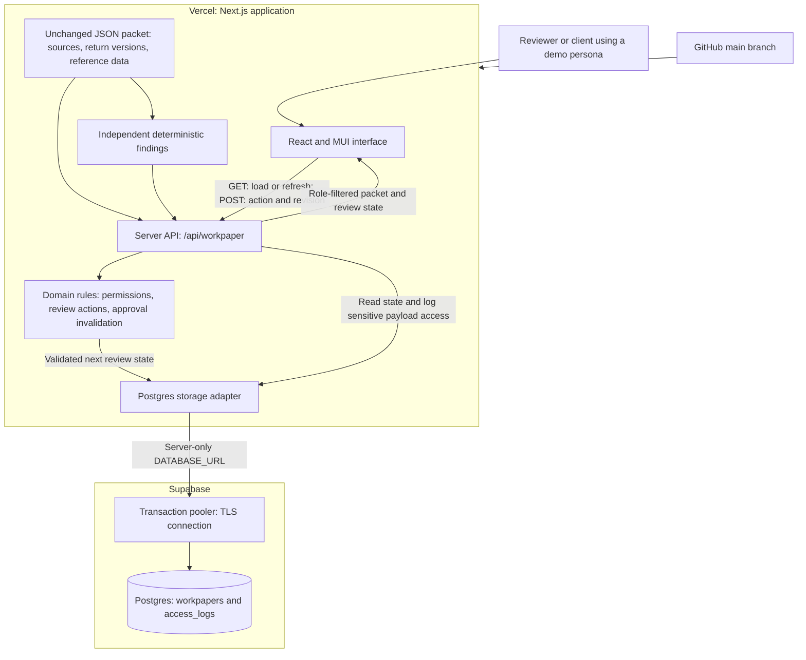
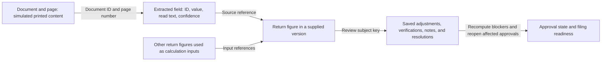
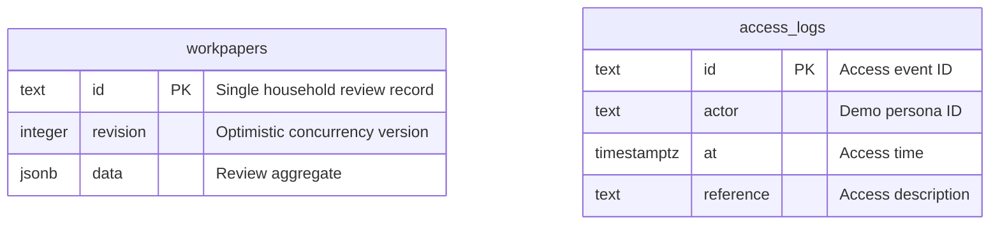
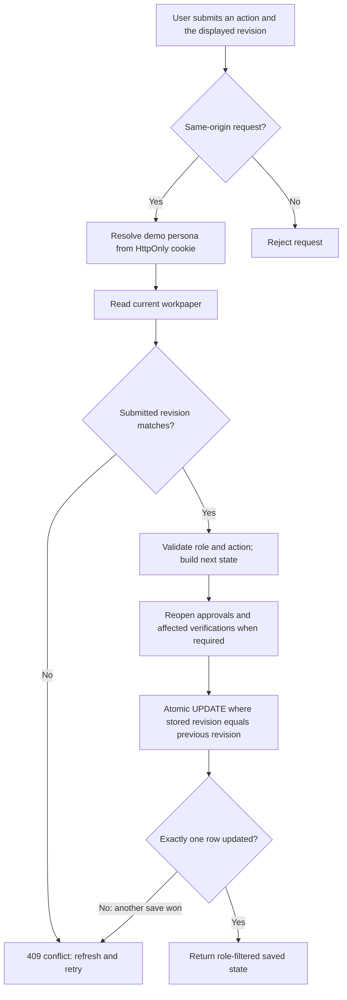

# Trace: architecture and data flow

This describes the deployed prototype. Source records come from the supplied fictional packet; review changes are persisted separately. No document-extraction service, external AI model, or authoritative tax engine runs in the application.

## 1. Deployed architecture

The browser calls the Next.js API. It does not connect directly to Postgres. The server uses a private connection string through Supabase's transaction pooler. GitHub pushes trigger Vercel deployments. Shared review changes refresh through polling every 15 seconds.

## 2. Evidence and review relationships

These are logical relationships between records, not separate SQL tables. Links also resolve reference data, client answers, prior-year records, and other supplied evidence. The UI supports reverse lookup from a document to the current return lines whose source references identify it. Extraction confidence and reviewer verification remain separate concepts.

## 3. Physical database model

There is no foreign key between these tables. Persona IDs resolve against the supplied packet.

| Storage | Contents |
|---|---|
| Bundled `lib/packet.json` | Documents, extracted values, engine versions, client records, staff, and reference information; unchanged by review actions |
| `workpapers.data` | Adjustments, verifications, issues, notes, questions, attachments, assignments, time, judgments, approvals, filing state, snapshots, and audit events |
| `workpapers.revision` | Revision checked atomically on every saved review action |
| `access_logs` | Server-side record of unmasked workpaper payload access; document-view actions also appear in the review audit |

The JSON aggregate is appropriate for one household and keeps state transitions easy to inspect. A multi-client production system would use more granular engagement, evidence, event, and attachment storage. Review audit entries and snapshots are application-maintained records, not a tamper-proof external ledger.

## 4. Saving a review action

The database comparison is necessary even after the initial revision check: another reviewer can save between reading and updating. Invalid actions are rejected by server-side domain rules. An adjustment records its explanation and estimated effect while preserving the original engine output.

## 5. Implementation boundaries

- Source documents are simulated from packet content; no OCR pipeline runs here.
- Findings are deterministic checks, independent of supplied engine diagnostics.
- Tax effects use supplied marginal rates; downstream engine figures are not fully recalculated.
- Personas demonstrate server-side permissions, not production authentication.
- Filing and signatures are simulated; no agency transmission occurs.
- Attachments are bounded and stored in the aggregate; exports are JSON records.
- Codex assisted development, analysis, tests, and documentation. No runtime external AI service receives the packet.

See [Approach and key decisions](APPROACH.md), [Findings](ERRORS.md), and [Deployment](VERCEL.md).
